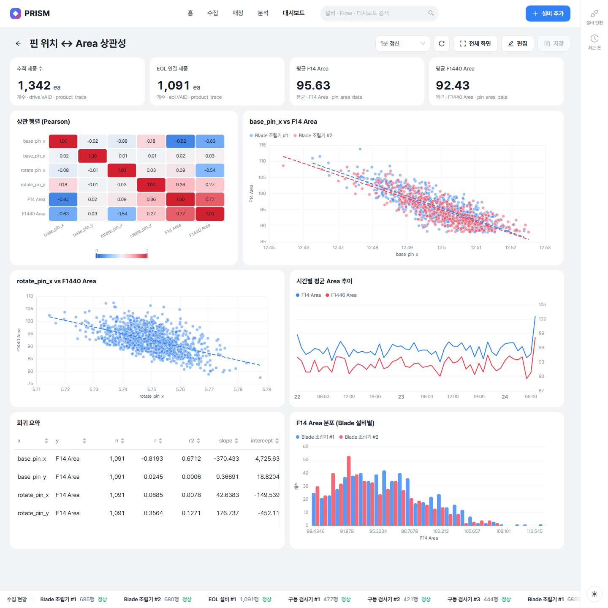
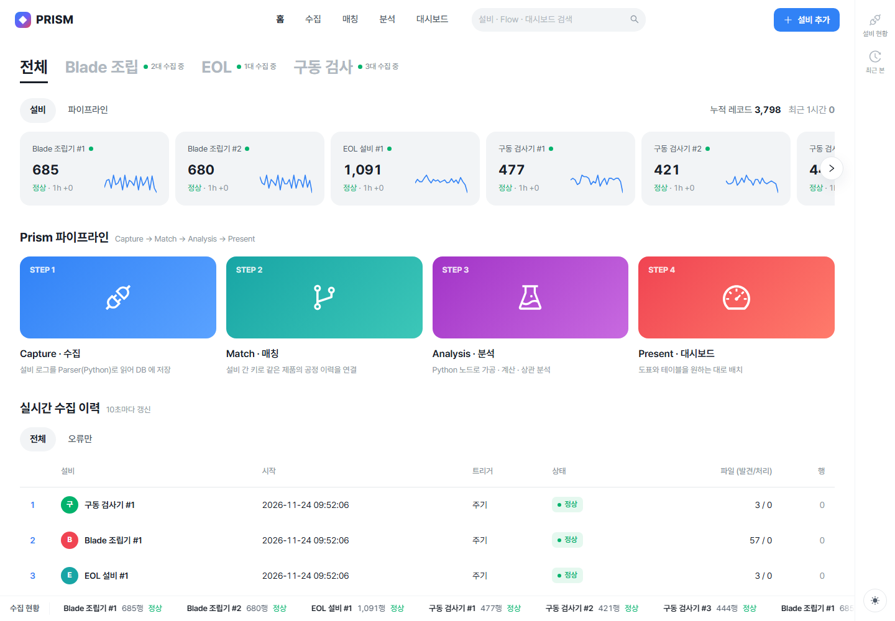
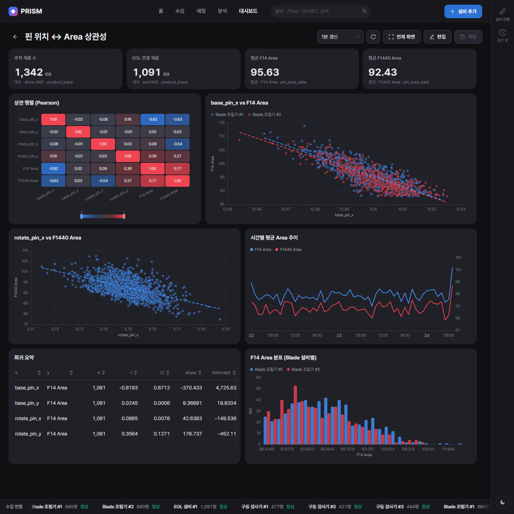
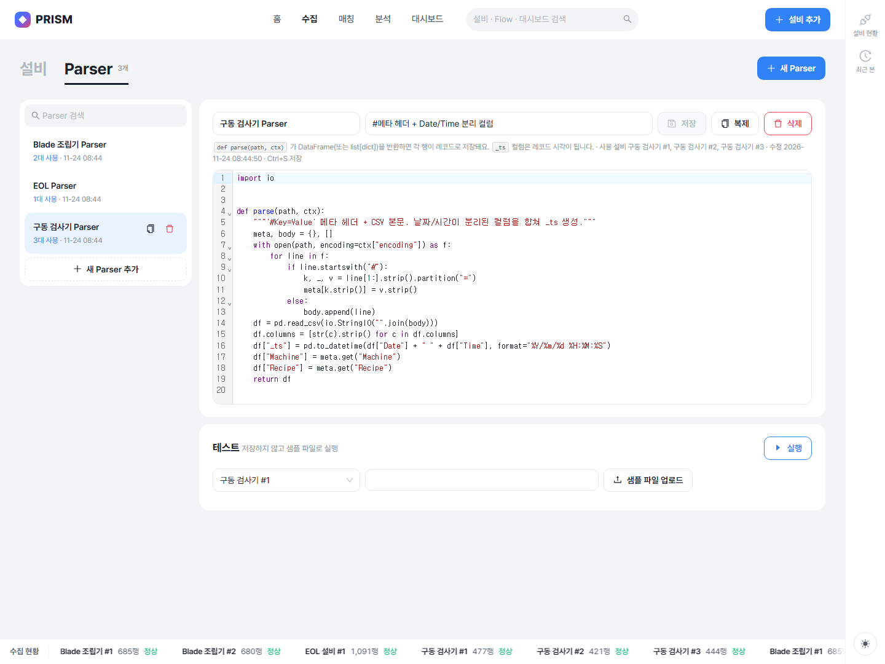
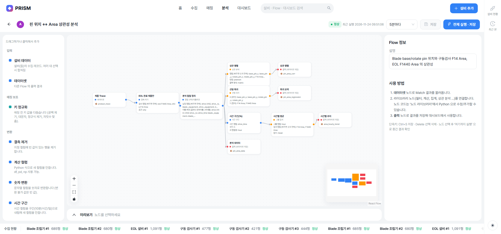
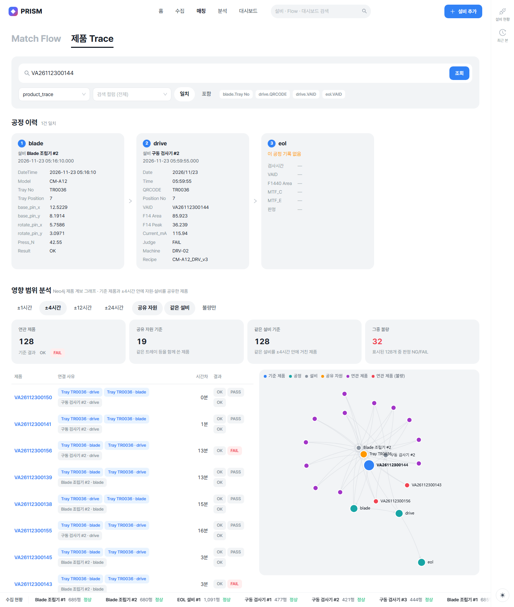

# PRISM

카메라 제조 공정 Tracking 시스템. 여러 설비의 로그를 모아 같은 제품끼리 공정 이력을 연결하고, 분석 결과를 대시보드로 보여줍니다.

```
Capture ──▶ Match ──▶ Analysis ──▶ Present
설비 로그 수집   설비 간 제품 연결   가공·계산·상관 분석   대시보드 · 제품 Trace
```

설비 추가, Parser, 매칭 규칙, 분석 노드, 대시보드 배치를 모두 **웹 화면에서** 바꿀 수 있어 코드 수정 없이 운영하는 것을 목표로 합니다.



<details>
<summary>홈 화면 · 다크 모드 보기</summary>





</details>

## 설치와 실행 (폐쇄망 포함)

서버에는 **아무것도 따로 설치하지 않습니다.** Python·PostgreSQL·Rust 엔진·화면 빌드가 모두 배포 폴더 안에 들어 있고, 인터넷 연결 없이 설치됩니다 (Windows x64).

| 실행 | 하는 일 |
|---|---|
| `install.bat` | 처음 한 번 (다시 실행해도 안전). 번들 Python·패키지 확인 → Rust 엔진·화면 확인 → PostgreSQL DB 생성(접속 정보는 `backend\.env`) → 테이블 생성 → `settings\` 설정 폴더가 있으면 들여오기 → Neo4j(번들에 있으면) 초기 비밀번호 |
| `run.bat` | PostgreSQL → Neo4j(있으면) → PRISM 서버(화면·API·수집·Flow 스케줄러)를 백그라운드로 시작하고 접속 주소를 보여 줌 |
| `stop.bat` | PRISM 서버(작업 프로세스·AI 에이전트 포함) → Neo4j → PostgreSQL 순서로 중지 |

- 옵션: `install.bat -NoDemo` (데모 없이), `install.bat -Settings D:\old\settings` (다른 위치의 설정 폴더), `install.bat -PgPort 5433`, `run.bat -Port 9000 -Open`
- 로그: `logs\backend.log` · `backend.err.log` · `postgres.log` · `neo4j.log` (직전 실행 로그는 `.1` 로 하나 남김)
- 서버를 옮길 때: 이전 서버에서 **Settings → Save to settings folder** → 그 `settings\` 폴더를 새 배포 폴더에 복사 → `install.bat` (아래 [서버 이전](#서버-이전-설정-폴더))
- 설비가 하나도 없는 DB 로 설치하면 **데모 시나리오**가 만들어집니다 (아래 [데모](#데모)). 끄려면 `-NoDemo` 또는 `PRISM_SEED_DEMO=0`.

### 배포 폴더 만들기 (인터넷이 되는 PC)

```powershell
.\scripts\build-bundle.ps1 -Zip            # → dist\PRISM\ (+ dist\PRISM-날짜.zip)
.\scripts\build-bundle.ps1 -WithSettings   # 이 PC 의 현재 설정을 settings\ 로 함께 넣음
.\scripts\build-bundle.ps1 -NoNeo4j        # Neo4j/JDK 제외 (약 350MB 절약)
```

`scripts\prepare-runtime.ps1` 이 먼저 실행되어 `.runtime\` 을 준비합니다: 이식형 Python 3.11 + 패키지(`.runtime\python`), 패키지 원본 wheel(`.runtime\wheels`, 폐쇄망에서 재설치용), PostgreSQL 바이너리(`.runtime\pgsql`), Rust 엔진/에이전트 빌드, 화면 빌드. 배포 폴더에는 DB·수집 데이터(`backend\data`)와 비밀번호(`backend\.env`)가 들어가지 않습니다. 크기는 Neo4j 제외 약 380MB 입니다.

### 개발 모드

```powershell
.\start.ps1    # 화면·Rust 엔진 소스가 바뀌었으면 다시 빌드한 뒤 이 창에서 실행 (Ctrl+C)

# 화면 개발 서버 (http://localhost:5173, /api 는 8000 으로 프록시)
npm --prefix frontend run dev
.\scripts\build-native.ps1   # Rust 엔진/에이전트만 다시 빌드 (cargo 필요, 서버를 멈춘 상태에서)
```

## 단계별 기능

### 1. Capture — 수집

- **설비 관리**: 공장 · 고객사 · 제품 · 과제 · 공정 · IP · 수집 주기 · 운영 상태 · Parser · 로그 경로를 화면에서 등록합니다. 삭제는 목록(여러 대 선택 가능) · 편집 · 상세 화면에서 할 수 있고, 함께 지워질 수집 데이터 양과 그 설비를 쓰는 Flow 를 먼저 보여줍니다 (Flow 의 설비 데이터 노드에서는 선택만 해제되고, 설비의 로그 원본은 그대로 남습니다).
- **접근 방식**
  - `fs` — 로컬 / UNC 공유 / 마운트 경로 (와일드카드 `*`, `**` 사용 가능)
  - `ftp`, `sftp`
  - `agent` — 서버가 직접 닿지 않는 별도 LAN 설비용 (아래 [에이전트](#별도-lan-설비-에이전트))
- **폴더 구조**
  - *경로에 파일이 바로 있음*: 지정한 폴더에서 바로 파일을 찾습니다.
  - *경로 아래 날짜별 폴더*: 상위 폴더(예 `\\{ip}\Log`)만 지정하면 그 아래 날짜 폴더를 자동으로 찾습니다. `20261124` · `2026-11-24` · `2026_11_24` · `261124` · `2026\11\24` · `2026-11\24` 를 모두 인식하며(최대 3단계), 조회 일수 안의 날짜 폴더만 확인합니다. FS · FTP · SFTP · Agent 모두 지원합니다.
- **경로 템플릿**: 날짜가 들어간 경로·파일명을 직접 지정할 수도 있습니다.

  | 치환자 | 예 |
  |---|---|
  | `{ip}` `{name}` `{factory}` `{customer}` `{product}` `{project}` `{process}` | `\\{ip}\Log` |
  | `{date:<strftime>}` | `{date:%Y%m%d}`, `Result_{date:%Y-%m-%d}*.csv` |

  `조회 일수`만큼 지난 날짜의 폴더·파일도 함께 확인합니다. 저장 전에 **경로/파일 확인** 버튼으로 실제로 잡히는 파일을 볼 수 있습니다.
- **증분 수집**: 이미 처리한 파일(크기·수정시각 동일)은 건너뜁니다. Parser 코드가 바뀌면 해당 파일을 자동으로 다시 파싱합니다.
- **Parser**: Python 코드로 작성하며 Parser 화면이나 설비 편집 화면에서 바로 추가 · 편집 · 복제 · 삭제할 수 있습니다. 저장하지 않고 샘플 파일로 실행해 결과를 미리 볼 수 있습니다.

```python
def parse(path, ctx):
    """
    path : 읽을 로그 파일의 로컬 경로 (원격 파일은 임시 파일로 내려받아 전달)
    ctx  : {"equipment": {...}, "encoding": "utf-8", "options": {...},
            "source_path": 원본 경로, "file_mtime": datetime}
    """
    df = prism.read_csv(path, encoding=ctx["encoding"])   # Rust CSV 파서 (pd.read_csv 도 그대로 사용 가능)
    df["_ts"] = pd.to_datetime(df["DateTime"])   # 레코드 시각 (없으면 파일 수정시각)
    return df                                     # DataFrame 또는 list[dict]
```

`pd`, `np`, `re`, `json`, `math`, `datetime`, `prism` 은 import 없이 쓸 수 있습니다.
`prism.read_csv(path, encoding=..., sep=",", skiprows=0, meta_prefix="#")` 는 pandas 와 같은 타입 추론(정수 → 실수 → 참/거짓 → 문자열)과 결측 표기를 따르고, `meta_prefix` 로 시작하는 `Key=Value` 줄은 표에서 빼서 `df.attrs["meta"]` 에 담습니다.




### 2. Match — 매칭

n8n 형태의 노드 편집기에서 설비를 연결해 같은 제품의 공정 이력을 한 행으로 모읍니다.

- **설비 데이터** 노드: 설비 여러 대를 하나로 합치고, 접두어(예: `blade.`)를 붙여 컬럼 충돌을 막습니다.
- **Match** 노드: 왼쪽(앞 공정)·오른쪽(다음 공정)의 키 컬럼 쌍으로 연결합니다.

  | 방식 | 용도 |
  |---|---|
  | 정확히 일치 | VAID처럼 고유한 키 |
  | 이후 최근접 시각 | 트레이처럼 **재사용되는 키** — 앞 공정 시각 이후 가장 가까운 기록 1건 |
  | 이전 / 앞뒤 최근접 시각 | 그 밖의 시간 기준 매칭 |

  키 정규화(공백 제거, `1.0` → `1`), 대소문자 무시, 최대 시간 차를 설정할 수 있습니다.
- **출력** 노드: 결과를 데이터셋으로 저장합니다. 노드를 선택하고 **여기까지 실행**을 누르면 중간 결과를 바로 확인할 수 있습니다.
- **제품 Trace 조회**: VAID · QR · Tray No 로 검색하면 공정별 이력을 순서대로 보여줍니다. `/trace?q=<제품키>` 링크로 바로 조회할 수도 있습니다.


### 3. Analysis — 분석

같은 노드 편집기에서 Match 결과를 가공합니다. 기본 노드 14종(행 필터, 계산 컬럼, 그룹 집계, 시간 구간, 상관 분석, 선형 회귀, 이상치 제거 등)이 제공되며, **노드 라이브러리**에서 모두 Python 코드로 수정하거나 새로 만들 수 있습니다. 파라미터를 정의하면 설정 폼이 자동으로 생성됩니다.

```python
def run(inputs, params):
    df = inputs[0]          # 연결된 입력 DataFrame 목록
    return df.query(params["expr"])
```

파라미터 타입: `string` `text` `number` `boolean` `select` `column` `columns` `json` (`column`/`columns` 는 입력 데이터의 컬럼 목록을 선택지로 보여줍니다)

Flow는 수동 실행 외에 1분 ~ 1일 주기로 자동 실행할 수 있습니다.



### 4. Present — 대시보드

- 차트(선, 영역, 막대, 산점도+추세선, 좌표 분포, 히스토그램, 박스플롯, 히트맵, 도넛) · 테이블 · 수치 · 텍스트 위젯을 끌어다 놓고 크기를 조절합니다.
- **좌표 분포 (X·Y 위치)**: 핀·부품 위치처럼 두 값이 한 점의 좌표인 데이터용입니다. 축 눈금을 1:1 로 맞춰 실제 모양대로 보여주고, 그룹별 평균 중심(+)과 기준 위치·허용 범위(원 또는 ±X/±Y 사각)를 그립니다. 범위를 벗어난 점은 ▲ 로 표시하고 개수와 비율을 보여줍니다.
- **데이터셋 겹치기**: 한 위젯에 데이터셋을 여러 개 넣을 수 있습니다. 같은 이름의 컬럼끼리 합쳐 데이터셋별로 색을 나누고, 컬럼명이 다르면 데이터셋마다 대응 컬럼을 고릅니다 (예: `base_pin_x` ↔ `blade.base_pin_x`). 테이블에는 `_dataset` 컬럼이 붙습니다.
- **선택 연동**: 테이블 위젯에 "행 클릭 시 선택할 값"(예: `VAID`)을 정하면, 행을 클릭할 때 다른 위젯이 그 값 기준으로 바뀝니다. Ctrl+클릭으로 여러 개를 고르고 Esc 로 해제합니다.
  - 각 위젯은 같은 이름의 컬럼을 자동으로 찾습니다. 접두어를 뗀 이름도 찾으므로 `VAID` 로 `drive.VAID` 를 찾습니다. 컬럼을 직접 지정하거나 반응하지 않게 할 수도 있습니다.
  - 산점도·좌표 분포는 전체 중에서 선택한 점을 강조하거나 선택한 것만 보여주고, 나머지 위젯은 해당 행만 보여줍니다. 필터는 서버에서 적용되므로 표시 행 수 제한과 관계없이 정확합니다.
- 자동 갱신과 전체 화면 모드(`/view/<id>`, 현장 모니터용)를 지원합니다.
- 데이터셋은 CSV로 내려받을 수 있습니다.

## Neo4j 제품 계보 그래프 (선택)

Match 결과를 Neo4j 그래프로 복사해 여러 단계를 건너는 추적 질문에 씁니다. 원본 데이터는 관계형 DB에 그대로 있고, Neo4j 를 설정하지 않아도 나머지 기능은 모두 동작합니다.

```
(:Product)-[:PASSED]->(:Step)-[:NEXT]->(:Step)      제품이 거친 공정 순서
(:Step)-[:ON]->(:Equipment)                          공정을 수행한 설비
(:Step)-[:USES]->(:Resource {kind:'Tray'})           여러 제품이 함께 쓴 자원 (트레이, 지그, 자재 Lot …)
```

- **Neo4j 그래프 저장** 노드 (Match Flow): 제품 키 컬럼과 공유 자원 컬럼을 지정합니다. 공정마다 이름이 달라도 같은 자원 종류로 묶으면 공정을 넘어 연결됩니다 (예: `blade.Tray No=Tray`, `drive.QRCODE=Tray`). Flow 를 실행할 때마다 그래프가 갱신됩니다.
- **영향 범위 분석** (제품 Trace 화면): 기준 제품과 ±N시간 안에 같은 자원·설비를 공유한 제품을 찾아 판정 결과(NG/FAIL)와 함께 보여줍니다. 불량 제품 하나에서 출하 보류 대상을 찾는 데 씁니다.
- **공정 이력 그래프**: 기준 제품 – 공정 – 설비 – 공유 자원 – 연관 제품 연결을 그래프로 보여줍니다. 노드를 누르면 그 제품으로 이동합니다.
- **Neo4j 조회 (Cypher)** 노드 (Analysis Flow): Cypher 결과를 표로 받아 분석·대시보드에 씁니다. 읽기 전용이며 쓰기 쿼리는 거부됩니다. 입력을 연결하면 그 행들이 `$rows` 로 전달됩니다.

```cypher
// EOL 불량 제품이 거친 Blade 설비별 개수
MATCH (p:Product {graph: 'product_trace'})-[:PASSED]->(e:Step {stage: 'eol'})
WHERE e.`판정` = 'NG'
MATCH (p)-[:PASSED]->(b:Step {stage: 'blade'})
RETURN b.equipment AS blade_equipment, count(p) AS ng_products
```



### 로컬 설치

```powershell
.\scripts\install-neo4j.ps1   # OpenJDK 21 + Neo4j Community 5.26 설치 (약 350MB, SHA-256 검증), 비밀번호 생성 → backend\.env
.\scripts\neo4j.ps1           # Neo4j 실행 (bolt://127.0.0.1:7687, 브라우저 http://127.0.0.1:7474)
```

이미 운영 중인 Neo4j 를 쓰려면 `backend\.env` 에 접속 정보만 넣으면 됩니다.

## PostgreSQL

설비·Parser·Flow·대시보드·수집 이력 같은 메타데이터를 담는 DB 입니다. 수집 레코드와 데이터셋은 DB 밖의 parquet 파일(`backend/data/records`, `backend/data/datasets`)이라 DB 종류와 무관합니다.
`PRISM_DATABASE_URL` 이 없으면 SQLite(`backend/data/prism.db`)를 쓰고, 설비가 많거나 수집·Flow 가 동시에 많이 돌면 PostgreSQL 을 권장합니다.

`install.bat` 이 번들 바이너리(`.runtime\pgsql`)로 `backend\data\postgres` 에 DB 클러스터(localhost 전용, UTF8)와 `prism` 계정/DB 를 만들고, 무작위 비밀번호와 접속 주소를 `backend\.env` 에 저장합니다. `run.bat` / `stop.bat` 이 함께 켜고 끕니다.

- 기존 SQLite 데이터 이전: 서버를 멈춘 상태에서 `cd backend; ..\.runtime\python\python.exe -m app.migrate_db` (한 트랜잭션, 실패하면 아무것도 바뀌지 않음). 원본 `prism.db` 는 그대로 남습니다.
- 이미 운영 중인 PostgreSQL 을 쓰려면 DB 를 만들고 `backend\.env` 에 `PRISM_DATABASE_URL=postgresql+psycopg://user:pw@host:5432/db` 만 넣은 뒤 `install.bat` 을 실행합니다 (번들 PostgreSQL 은 쓰지 않음).

## 서버 이전 (설정 폴더)

오른쪽 레일의 **Settings → Move to another server** 에서 설비·Parser·노드 라이브러리·Match/Analysis Flow·대시보드를 **설정 폴더**(기본 `settings\`) 에 항목별 하위 폴더와 파일로 저장합니다. 코드는 `.py`, 설정은 `.json` 이라 파일을 열어 보거나 git 등으로 변경 이력을 남기기 쉽습니다.

```
settings\
  prism-settings.json              목록 (내보낸 시각, 항목 수, 형식 버전)
  README.txt
  parsers\<이름>.json, .py           Parser 설명 + 코드
  node-library\<key>.json, .py      노드 라이브러리 정의 + 코드
  equipment\<설비명>.json            설비 설정 (Parser 는 이름으로 참조)
  flows\match\<이름>.json            Match Flow (설비 데이터 노드는 설비 이름으로 참조)
  flows\analysis\<이름>.json         Analysis Flow
  dashboards\<이름>.json             대시보드
  secrets\equipment-passwords.json   FTP/SFTP 비밀번호 (내보낼 때 선택한 경우에만)
```

- 옮기는 순서: 이전 서버에서 **Save to settings folder** → `settings\` 를 새 서버의 PRISM 폴더에 복사 → `install.bat` (자동으로 들여옴). 이미 설치된 서버라면 화면에서 *This server's settings folder* 를 고르거나 폴더/zip 을 올려 들여옵니다. **Download as zip** 으로 같은 구조를 zip 으로 받을 수도 있습니다.
- 서버마다 달라지는 DB id 대신 **이름**으로 서로를 가리킵니다 (Flow 의 설비 데이터 노드 → 설비 이름, 설비 → Parser 이름). 새 서버에서 같은 이름으로 다시 연결됩니다.
- 들여오기 전에 무엇이 새로 생기고 / 덮어써지고 / 건너뛰어지는지, 새 서버에 없는 설비를 가리키는 Flow 가 있는지 미리 보여 줍니다.
- 기본값은 **같은 이름이면 건너뛰기**, **설비 수집·Flow 자동 실행은 꺼진 채로** 들여오기입니다 (새 서버에서 경로·계정을 확인한 뒤 켜도록).
- 수집 레코드·데이터셋은 데이터라서 들어가지 않습니다. Flow 를 실행하면 데이터셋이 다시 만들어지고, 수집 이력까지 옮기려면 `backend\data` 폴더를 복사합니다.
- `settings\` 는 git 에서 제외되어 있습니다 (비밀번호가 들어갈 수 있음). 설정 이력을 관리하려면 비밀번호 없이 저장한 폴더를 별도 저장소로 관리하세요.

```powershell
cd backend
..\.runtime\python\python.exe -m app.workspace export            # settings\ 에 저장 (--secrets, --zip 파일.zip)
..\.runtime\python\python.exe -m app.workspace import --dry-run  # settings\ 를 들여오면 무엇이 바뀌는지
..\.runtime\python\python.exe -m app.workspace import D:\settings.zip --overwrite --activate
```

Flow 하나만 내보내기(Flow 화면)도 같은 규칙(설비 이름)을 씁니다.

## Rust 엔진

무거운 데이터 처리는 Rust 로 만든 확장 모듈 `prism_core`(`backend\app\prism_core.pyd`, 소스 `native\prism_core`)가 맡습니다. pyarrow(C++)는 쓰지 않습니다.

| 부분 | 내용 |
|---|---|
| 저장 | 수집 레코드·데이터셋 parquet 읽기/쓰기 (컬럼 묶음 단위 병렬 인코딩·디코딩), 스키마 합치기, 행 범위/선택 읽기, upsert 키 비교, CSV 내보내기 |
| 파싱 | Parser 용 CSV 파서 `prism.read_csv` (여러 스레드, cp949 등 인코딩, `#Key=Value` 메타 줄) |
| 매칭 | Match 노드의 키 정규화와 짝 찾기 (exact / 가장 가까운 시각, 허용 시간). 행 순서까지 예전 pandas 구현과 같음 |

사용자 Parser · Python 노드 · 노드 라이브러리 코드는 그대로 Python(pandas)으로 실행됩니다. 기존 parquet 파일은 그대로 읽히고, 새로 쓴 파일도 다른 도구(pyarrow 등)로 읽을 수 있습니다.

## AI Agent

오른쪽 레일의 **AI Agent** 에서 하고 싶은 분석을 글로 적으면, 에이전트가 데이터를 살펴보고 **Match Flow → Analysis Flow → 대시보드**까지 만들어 실행합니다.

- 에이전트 준비: **Download → Start → Check** 순서. 지금은 이 서버 PC 에 로그인된 **Claude Code CLI** 를 임시로 씁니다 (내려받기 없음). 전용 에이전트(PRISM AI Agent)는 배포 서버가 생기면 같은 화면에서 내려받아 씁니다.
- 에이전트는 [`.claude/skills/prism-builder`](.claude/skills/prism-builder/SKILL.md) 스킬을 따릅니다. 스킬의 helper(`scripts/prism.py`, 표준 라이브러리만 사용)로 PRISM API 만 호출하며, 기존 Flow·데이터셋·대시보드를 지우거나 덮어쓰지 않고 자동 실행도 켜지 않습니다.
- 요청마다 `backend\data\agent\jobs\<번호>` 작업 폴더에서 실행되고, 셸 명령은 helper 만 허용됩니다. DB·Neo4j 비밀번호 같은 환경변수는 에이전트에 넘기지 않습니다.
- 진행 기록·만든 항목·결과 보고가 패널에 남습니다. 한 번에 한 요청만 실행합니다.
- 같은 스킬은 이 저장소를 Claude Code 로 열었을 때도 그대로 쓸 수 있습니다.
- Claude Code 는 Anthropic API 에 접속해야 하므로 인터넷이 막힌 서버에서는 동작하지 않습니다.

## 네트워크 구성과 수집 방식

| 설비 위치 | 방식 |
|---|---|
| 서버에서 직접 접근 가능 (OA/FA 망) | `fs`(UNC 공유) · `ftp` · `sftp` 로 서버가 주기적으로 가져옴 |
| 대표 설비 PC · 작업 PC 뒤의 별도 LAN | 게이트웨이 PC에서 에이전트가 찾아 서버로 전송 |

### 별도 LAN 설비 에이전트

`agent\prism-agent.exe` (Rust, 약 1MB) 하나만 게이트웨이 PC 에 복사하면 됩니다. Python 등 설치가 필요 없고, 설비 편집 화면(접근 방식 `agent`)의 링크나 `http://<서버IP>:8000/api/agent/download` 에서 내려받을 수 있습니다.

```powershell
prism-agent.exe --server http://<서버IP>:8000 --equipment "Blade 조립기 #2" --equipment "Blade 조립기 #3"
```

- 경로·패턴·주기는 서버 화면의 설비 설정(접근 방식 `agent`)을 받아 씁니다. 경로는 게이트웨이 PC 기준입니다.
- 서버에 이미 있는 파일과 비교해 바뀐 파일만 전송합니다.
- `--once`: 한 번만 동기화하고 종료, `--token`: 서버에 `PRISM_AGENT_TOKEN` 을 설정한 경우
- 사내망 `http://` 주소 전용입니다 (TLS 라이브러리를 넣지 않아 실행 파일이 작고 C 컴파일 없이 빌드됨).

## 데모

`demo/logs/` 에 최근 3일치 가짜 로그를 만들고 아래를 등록합니다.

- 설비 6대: Blade 조립기 #1·#2 (날짜 폴더), 구동 검사기 #1~#3 (날짜 파일명 + `#Key=Value` 메타 헤더), EOL 설비 #1 (cp949 한글 헤더)
- Match Flow: Blade `Tray No`+`Tray Position` ↔ 구동 검사기 `QRCODE`+`Position No` (이후 최근접 시각), 구동 검사기 `VAID` ↔ EOL `VAID` (정확히 일치)
- Analysis Flow: base/rotate pin 위치와 F14 Area · F1440 Area 의 상관 행렬, 회귀 요약, 시간별 추이
- 대시보드: 핀 위치 ↔ Area 상관성

## 환경변수

| 변수 | 기본값 | 설명 |
|---|---|---|
| `PRISM_DATABASE_URL` | `sqlite:///backend/data/prism.db` | 운영은 PostgreSQL 권장 (`postgresql+psycopg://...`, 위 [PostgreSQL](#postgresql) 참고) |
| `PRISM_DATA_DIR` | `backend/data` | SQLite DB · 수집 레코드 · 데이터셋(parquet) · 임시 업로드 폴더 |
| `PRISM_SETTINGS_DIR` | `settings` | 서버 이전용 설정 폴더 |
| `PRISM_PORT` | `8000` | `run.bat` 이 쓰는 서비스 포트 (`backend\.env` 에 적어 두면 됨) |
| `PRISM_SCHEDULER` | `1` | `0` 이면 자동 수집 / Flow 자동 실행 끔 |
| `PRISM_CAPTURE_WORKERS` | `4` | 수집을 동시에 실행하는 작업 프로세스 수 (`PRISM_WORKERS` 도 인식) |
| `PRISM_FLOW_WORKERS` | `2` | Flow 실행 · 미리보기를 동시에 실행하는 작업 프로세스 수 |
| `PRISM_CACHE_MB` | `1024` | 데이터셋 조회 결과 메모리 캐시 한도 |
| `PRISM_CLAUDE_BIN` | (PATH 의 `claude`) | AI Agent 가 쓸 Claude Code CLI 경로 |
| `PRISM_AI_API_URL` | `http://127.0.0.1:8000` | AI Agent 가 호출할 PRISM API 주소 (다른 포트로 실행하면 맞춰 줌) |
| `PRISM_AI_TIMEOUT_MIN` | `30` | AI 요청 한 건의 최대 실행 시간(분) |
| `PRISM_AI_MODEL` | (Claude Code 기본값) | AI Agent 모델 |
| `PRISM_AGENT_TOKEN` | (없음) | 설정하면 에이전트 업로드 시 토큰 검사 |
| `PRISM_SEED_DEMO` | `1` | 빈 DB일 때 데모 시나리오 생성 |
| `PRISM_NEO4J_URI` | (없음) | 예 `bolt://127.0.0.1:7687`. 비어 있으면 Neo4j 기능 꺼짐 |
| `PRISM_NEO4J_USER` / `PRISM_NEO4J_PASSWORD` | `neo4j` / (없음) | Neo4j 계정 |
| `PRISM_NEO4J_DATABASE` | `neo4j` | 사용할 데이터베이스 |
| `PRISM_ALERT_WEBHOOK` | (없음) | Slack 등 incoming webhook URL. 설정하면 설비 수집/Flow 실행이 오류↔정상 상태를 오갈 때 알림 전송 |
| `PRISM_ALERT_MIN_INTERVAL_SEC` | `300` | 같은 설비/Flow 는 이 시간(초) 안에 한 번만 알림 (상태가 자주 바뀌어도 스팸 방지) |

환경변수는 `backend\.env` 파일(`KEY=VALUE`, git 제외)에 적어 두어도 됩니다. 이미 설정된 환경변수가 우선합니다.

## 구조

```
backend/app/
  api/          REST API (설비, Parser, Flow, 노드, 데이터셋, 대시보드, Trace, 에이전트)
  capture/      로그 파일 탐색 · 가져오기(fs/ftp/sftp) · 파싱 · 저장
  engine/       노드 그래프 실행기, 내장 노드(source/match/union/dataset/output/python/graph/cypher), 사용자 코드 실행
  graph.py      Neo4j 제품 계보 그래프 저장 · 영향 범위 분석 · Cypher 조회
  models.py     DB 모델 (SQLite 또는 PostgreSQL). 로그 레코드는 수집 파일별 parquet → 설비별 스키마 변경 불필요
  migrate_db.py SQLite → PostgreSQL 데이터 이전
  workspace.py  설정 폴더 내보내기/들여오기 (서버 이전)
  setup.py      install.bat 의 DB 준비 단계
  ai_agent.py   AI Agent 실행 (Claude Code CLI + prism-builder 스킬)
  scheduler.py  수집 주기 · Flow 자동 실행
  seed*.py      기본 노드 라이브러리 · 데모 시나리오
  engine/native.py  Rust 엔진(prism_core) ↔ pandas 연결
native/         Rust 소스: prism_core (저장·CSV 파서·매칭, Python 확장 모듈), prism_agent (게이트웨이 에이전트 exe)
agent/          prism-agent.exe (빌드 결과)
scripts/        install / run / stop / build-bundle / prepare-runtime / build-native
.claude/skills/prism-builder/  매칭 → 분석 → 대시보드 생성 스킬 (SKILL.md, reference/, scripts/prism.py)
frontend/src/   React + Ant Design + React Flow + ECharts (토스증권 데스크탑 스타일, 라이트/다크 모드)
```

## 운영 시 주의

- Parser와 노드 코드는 서버 프로세스 안에서 그대로 실행됩니다. 사내 엔지니어만 쓰는 도구를 전제로 하며, 코드 작성 권한을 제한하려면 인증 기능을 추가해야 합니다.
- FTP/SFTP 비밀번호는 DB에 암호화 없이 저장됩니다.
- 사내망이 인터넷과 분리되어 있어도 동작하도록 글꼴(Pretendard) 등 화면 자원은 모두 빌드에 포함됩니다.
