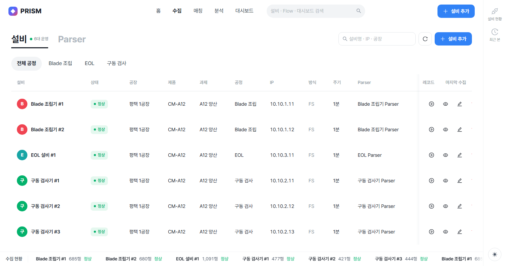
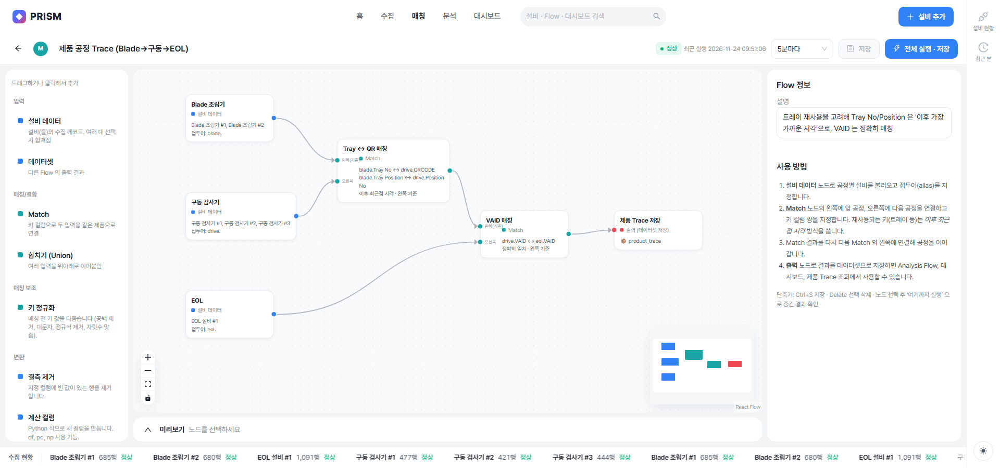
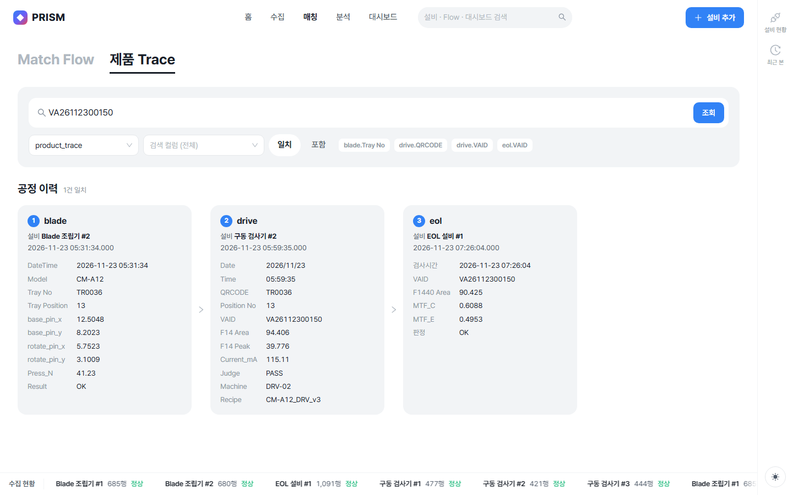

# PRISM

카메라 제조 공정 Tracking 시스템. 여러 설비의 로그를 모아 같은 제품끼리 공정 이력을 연결하고, 분석 결과를 대시보드로 보여줍니다.

```
Capture ──▶ Match ──▶ Analysis ──▶ Present
설비 로그 수집   설비 간 제품 연결   가공·계산·상관 분석   대시보드 · 제품 Trace
```

설비 추가, Parser, 매칭 규칙, 분석 노드, 대시보드 배치를 모두 **웹 화면에서** 바꿀 수 있어 코드 수정 없이 운영하는 것을 목표로 합니다.


<details>
<summary>홈 화면 · 다크 모드 보기</summary>


</details>

## 빠른 시작

필요: Python 3.11+, Node.js 18+ (Windows 기준)

```powershell
.\start.ps1
```

처음 실행하면 Python 가상환경과 npm 패키지를 설치하고 화면을 빌드한 뒤 `http://<서버IP>:8000` 으로 서비스합니다.

| 옵션 | 설명 |
|---|---|
| `.\start.ps1 -Rebuild` | 프론트엔드를 다시 빌드 |
| `.\start.ps1 -Port 9000` | 다른 포트로 실행 |

설비가 하나도 없는 DB로 처음 띄우면 **데모 시나리오**가 자동으로 만들어집니다 (아래 [데모](#데모) 참고). 끄려면 `PRISM_SEED_DEMO=0`.

### 개발 모드

```powershell
# 백엔드 (http://127.0.0.1:8000)
backend\.venv\Scripts\python.exe -m uvicorn app.main:app --app-dir backend --port 8000

# 프론트엔드 (http://localhost:5173, /api 는 8000 으로 프록시)
npm --prefix frontend run dev
```

## 단계별 기능

### 1. Capture — 수집

- **설비 관리**: 공장 · 고객사 · 제품 · 과제 · 공정 · IP · 수집 주기 · 운영 상태 · Parser · 로그 경로를 화면에서 등록합니다. 삭제는 목록(여러 대 선택 가능) · 편집 · 상세 화면에서 할 수 있고, 함께 지워질 수집 데이터 양과 그 설비를 쓰는 Flow 를 먼저 보여줍니다 (Flow 의 설비 데이터 노드에서는 선택만 해제되고, 설비의 로그 원본은 그대로 남습니다).
- **접근 방식**
  - `fs` — 로컬 / UNC 공유 / 마운트 경로 (와일드카드 `*`, `**` 사용 가능)
  - `ftp`, `sftp`
  - `agent` — 서버가 직접 닿지 않는 별도 LAN 설비용 (아래 [에이전트](#별도-lan-설비-에이전트))
- **폴더 구조**
  - *경로에 파일이 바로 있음*: 지정한 폴더에서 바로 파일을 찾습니다.
  - *경로 아래 날짜별 폴더*: 상위 폴더(예 `\\{ip}\Log`)만 지정하면 그 아래 날짜 폴더를 자동으로 찾습니다. `20261124` · `2026-11-24` · `2026_11_24` · `261124` · `2026\11\24` · `2026-11\24` 를 모두 인식하며(최대 3단계), 조회 일수 안의 날짜 폴더만 확인합니다. FS · FTP · SFTP · Agent 모두 지원합니다.
- **경로 템플릿**: 날짜가 들어간 경로·파일명을 직접 지정할 수도 있습니다.

  | 치환자 | 예 |
  |---|---|
  | `{ip}` `{name}` `{factory}` `{customer}` `{product}` `{project}` `{process}` | `\\{ip}\Log` |
  | `{date:<strftime>}` | `{date:%Y%m%d}`, `Result_{date:%Y-%m-%d}*.csv` |

  `조회 일수`만큼 지난 날짜의 폴더·파일도 함께 확인합니다. 저장 전에 **경로/파일 확인** 버튼으로 실제로 잡히는 파일을 볼 수 있습니다.
- **증분 수집**: 이미 처리한 파일(크기·수정시각 동일)은 건너뜁니다. Parser 코드가 바뀌면 해당 파일을 자동으로 다시 파싱합니다.
- **Parser**: Python 코드로 작성하며 Parser 화면이나 설비 편집 화면에서 바로 추가 · 편집 · 복제 · 삭제할 수 있습니다. 저장하지 않고 샘플 파일로 실행해 결과를 미리 볼 수 있습니다.

```python
def parse(path, ctx):
    """
    path : 읽을 로그 파일의 로컬 경로 (원격 파일은 임시 파일로 내려받아 전달)
    ctx  : {"equipment": {...}, "encoding": "utf-8", "options": {...},
            "source_path": 원본 경로, "file_mtime": datetime}
    """
    df = pd.read_csv(path, encoding=ctx["encoding"])
    df["_ts"] = pd.to_datetime(df["DateTime"])   # 레코드 시각 (없으면 파일 수정시각)
    return df                                     # DataFrame 또는 list[dict]
```

`pd`, `np`, `re`, `json`, `math`, `datetime` 은 import 없이 쓸 수 있습니다.




### 2. Match — 매칭

n8n 형태의 노드 편집기에서 설비를 연결해 같은 제품의 공정 이력을 한 행으로 모읍니다.

- **설비 데이터** 노드: 설비 여러 대를 하나로 합치고, 접두어(예: `blade.`)를 붙여 컬럼 충돌을 막습니다.
- **Match** 노드: 왼쪽(앞 공정)·오른쪽(다음 공정)의 키 컬럼 쌍으로 연결합니다.

  | 방식 | 용도 |
  |---|---|
  | 정확히 일치 | VAID처럼 고유한 키 |
  | 이후 최근접 시각 | 트레이처럼 **재사용되는 키** — 앞 공정 시각 이후 가장 가까운 기록 1건 |
  | 이전 / 앞뒤 최근접 시각 | 그 밖의 시간 기준 매칭 |

  키 정규화(공백 제거, `1.0` → `1`), 대소문자 무시, 최대 시간 차를 설정할 수 있습니다.
- **출력** 노드: 결과를 데이터셋으로 저장합니다. 노드를 선택하고 **여기까지 실행**을 누르면 중간 결과를 바로 확인할 수 있습니다.
- **제품 Trace 조회**: VAID · QR · Tray No 로 검색하면 공정별 이력을 순서대로 보여줍니다. `/trace?q=<제품키>` 링크로 바로 조회할 수도 있습니다.





### 3. Analysis — 분석

같은 노드 편집기에서 Match 결과를 가공합니다. 기본 노드 14종(행 필터, 계산 컬럼, 그룹 집계, 시간 구간, 상관 분석, 선형 회귀, 이상치 제거 등)이 제공되며, **노드 라이브러리**에서 모두 Python 코드로 수정하거나 새로 만들 수 있습니다. 파라미터를 정의하면 설정 폼이 자동으로 생성됩니다.

```python
def run(inputs, params):
    df = inputs[0]          # 연결된 입력 DataFrame 목록
    return df.query(params["expr"])
```

파라미터 타입: `string` `text` `number` `boolean` `select` `column` `columns` `json` (`column`/`columns` 는 입력 데이터의 컬럼 목록을 선택지로 보여줍니다)

Flow는 수동 실행 외에 1분 ~ 1일 주기로 자동 실행할 수 있습니다.


### 4. Present — 대시보드

- 차트(선, 영역, 막대, 산점도+추세선, 히스토그램, 박스플롯, 히트맵, 도넛) · 테이블 · 수치 · 텍스트 위젯을 끌어다 놓고 크기를 조절합니다.
- 자동 갱신과 전체 화면 모드(`/view/<id>`, 현장 모니터용)를 지원합니다.
- 데이터셋은 CSV로 내려받을 수 있습니다.

## Neo4j 제품 계보 그래프 (선택)

Match 결과를 Neo4j 그래프로 복사해 여러 단계를 건너는 추적 질문에 씁니다. 원본 데이터는 관계형 DB에 그대로 있고, Neo4j 를 설정하지 않아도 나머지 기능은 모두 동작합니다.

```
(:Product)-[:PASSED]->(:Step)-[:NEXT]->(:Step)      제품이 거친 공정 순서
(:Step)-[:ON]->(:Equipment)                          공정을 수행한 설비
(:Step)-[:USES]->(:Resource {kind:'Tray'})           여러 제품이 함께 쓴 자원 (트레이, 지그, 자재 Lot …)
```

- **Neo4j 그래프 저장** 노드 (Match Flow): 제품 키 컬럼과 공유 자원 컬럼을 지정합니다. 공정마다 이름이 달라도 같은 자원 종류로 묶으면 공정을 넘어 연결됩니다 (예: `blade.Tray No=Tray`, `drive.QRCODE=Tray`). Flow 를 실행할 때마다 그래프가 갱신됩니다.
- **영향 범위 분석** (제품 Trace 화면): 기준 제품과 ±N시간 안에 같은 자원·설비를 공유한 제품을 찾아 판정 결과(NG/FAIL)와 함께 보여줍니다. 불량 제품 하나에서 출하 보류 대상을 찾는 데 씁니다.
- **공정 이력 그래프**: 기준 제품 – 공정 – 설비 – 공유 자원 – 연관 제품 연결을 그래프로 보여줍니다. 노드를 누르면 그 제품으로 이동합니다.
- **Neo4j 조회 (Cypher)** 노드 (Analysis Flow): Cypher 결과를 표로 받아 분석·대시보드에 씁니다. 읽기 전용이며 쓰기 쿼리는 거부됩니다. 입력을 연결하면 그 행들이 `$rows` 로 전달됩니다.

```cypher
// EOL 불량 제품이 거친 Blade 설비별 개수
MATCH (p:Product {graph: 'product_trace'})-[:PASSED]->(e:Step {stage: 'eol'})
WHERE e.`판정` = 'NG'
MATCH (p)-[:PASSED]->(b:Step {stage: 'blade'})
RETURN b.equipment AS blade_equipment, count(p) AS ng_products
```


### 로컬 설치

```powershell
.\scripts\install-neo4j.ps1   # OpenJDK 21 + Neo4j Community 5.26 설치 (약 350MB, SHA-256 검증), 비밀번호 생성 → backend\.env
.\scripts\neo4j.ps1           # Neo4j 실행 (bolt://127.0.0.1:7687, 브라우저 http://127.0.0.1:7474)
```

이미 운영 중인 Neo4j 를 쓰려면 `backend\.env` 에 접속 정보만 넣으면 됩니다.

## 네트워크 구성과 수집 방식

| 설비 위치 | 방식 |
|---|---|
| 서버에서 직접 접근 가능 (OA/FA 망) | `fs`(UNC 공유) · `ftp` · `sftp` 로 서버가 주기적으로 가져옴 |
| 대표 설비 PC · 작업 PC 뒤의 별도 LAN | 게이트웨이 PC에서 에이전트가 찾아 서버로 전송 |

### 별도 LAN 설비 에이전트

`agent/prism_agent.py` 는 Python 표준 라이브러리만 사용하므로 게이트웨이 PC에 파일 하나만 복사하면 됩니다.

```powershell
python prism_agent.py --server http://<서버IP>:8000 --equipment "Blade 조립기 #2" --equipment "Blade 조립기 #3"
```

- 경로·패턴·주기는 서버 화면의 설비 설정(접근 방식 `agent`)을 받아 씁니다. 경로는 게이트웨이 PC 기준입니다.
- 서버에 이미 있는 파일과 비교해 바뀐 파일만 전송합니다.
- `--once`: 한 번만 동기화하고 종료, `--token`: 서버에 `PRISM_AGENT_TOKEN` 을 설정한 경우

## 데모

`demo/logs/` 에 최근 3일치 가짜 로그를 만들고 아래를 등록합니다.

- 설비 6대: Blade 조립기 #1·#2 (날짜 폴더), 구동 검사기 #1~#3 (날짜 파일명 + `#Key=Value` 메타 헤더), EOL 설비 #1 (cp949 한글 헤더)
- Match Flow: Blade `Tray No`+`Tray Position` ↔ 구동 검사기 `QRCODE`+`Position No` (이후 최근접 시각), 구동 검사기 `VAID` ↔ EOL `VAID` (정확히 일치)
- Analysis Flow: base/rotate pin 위치와 F14 Area · F1440 Area 의 상관 행렬, 회귀 요약, 시간별 추이
- 대시보드: 핀 위치 ↔ Area 상관성

## 환경변수

| 변수 | 기본값 | 설명 |
|---|---|---|
| `PRISM_DATABASE_URL` | `sqlite:///backend/data/prism.db` | 운영은 PostgreSQL 권장 (`postgresql+psycopg://...`, `psycopg[binary]` 설치 필요) |
| `PRISM_DATA_DIR` | `backend/data` | DB · 데이터셋(parquet) · 임시 업로드 폴더 |
| `PRISM_SCHEDULER` | `1` | `0` 이면 자동 수집 / Flow 자동 실행 끔 |
| `PRISM_WORKERS` | `4` | 수집 · Flow 동시 실행 수 |
| `PRISM_AGENT_TOKEN` | (없음) | 설정하면 에이전트 업로드 시 토큰 검사 |
| `PRISM_SEED_DEMO` | `1` | 빈 DB일 때 데모 시나리오 생성 |
| `PRISM_NEO4J_URI` | (없음) | 예 `bolt://127.0.0.1:7687`. 비어 있으면 Neo4j 기능 꺼짐 |
| `PRISM_NEO4J_USER` / `PRISM_NEO4J_PASSWORD` | `neo4j` / (없음) | Neo4j 계정 |
| `PRISM_NEO4J_DATABASE` | `neo4j` | 사용할 데이터베이스 |

환경변수는 `backend\.env` 파일(`KEY=VALUE`, git 제외)에 적어 두어도 됩니다. 이미 설정된 환경변수가 우선합니다.

## 구조

```
backend/app/
  api/          REST API (설비, Parser, Flow, 노드, 데이터셋, 대시보드, Trace, 에이전트)
  capture/      로그 파일 탐색 · 가져오기(fs/ftp/sftp) · 파싱 · 저장
  engine/       노드 그래프 실행기, 내장 노드(source/match/union/dataset/output/python/graph/cypher), 사용자 코드 실행
  graph.py      Neo4j 제품 계보 그래프 저장 · 영향 범위 분석 · Cypher 조회
  models.py     DB 모델 (로그 레코드는 JSON 으로 저장 → 설비별 스키마 변경 불필요)
  scheduler.py  수집 주기 · Flow 자동 실행
  seed*.py      기본 노드 라이브러리 · 데모 시나리오
agent/          별도 LAN 설비용 수집 에이전트
frontend/src/   React + Ant Design + React Flow + ECharts (토스증권 데스크탑 스타일, 라이트/다크 모드)
```

## 운영 시 주의

- Parser와 노드 코드는 서버 프로세스 안에서 그대로 실행됩니다. 사내 엔지니어만 쓰는 도구를 전제로 하며, 코드 작성 권한을 제한하려면 인증 기능을 추가해야 합니다.
- FTP/SFTP 비밀번호는 DB에 암호화 없이 저장됩니다.
- 사내망이 인터넷과 분리되어 있어도 동작하도록 글꼴(Pretendard) 등 화면 자원은 모두 빌드에 포함됩니다.
